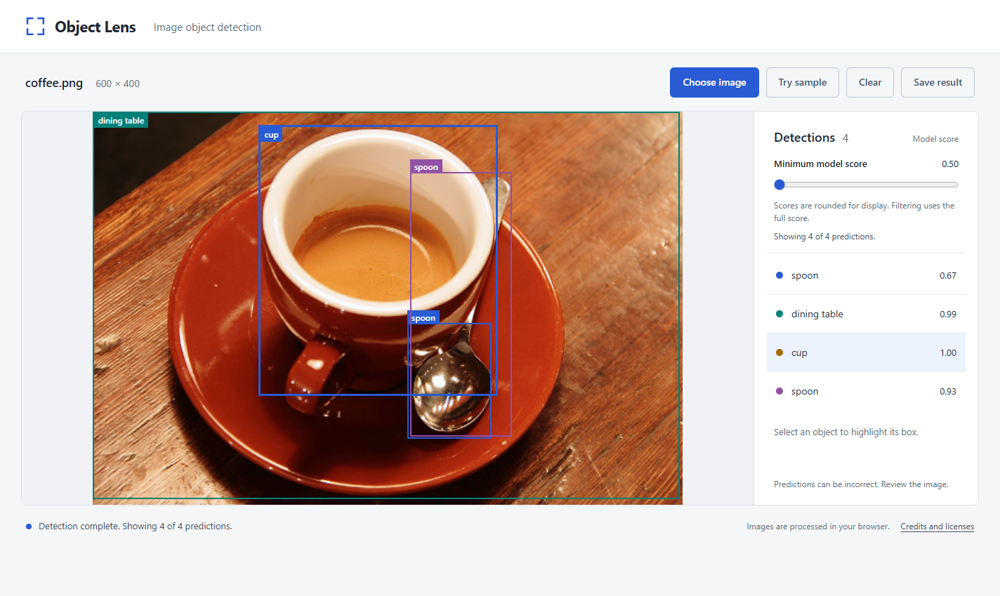
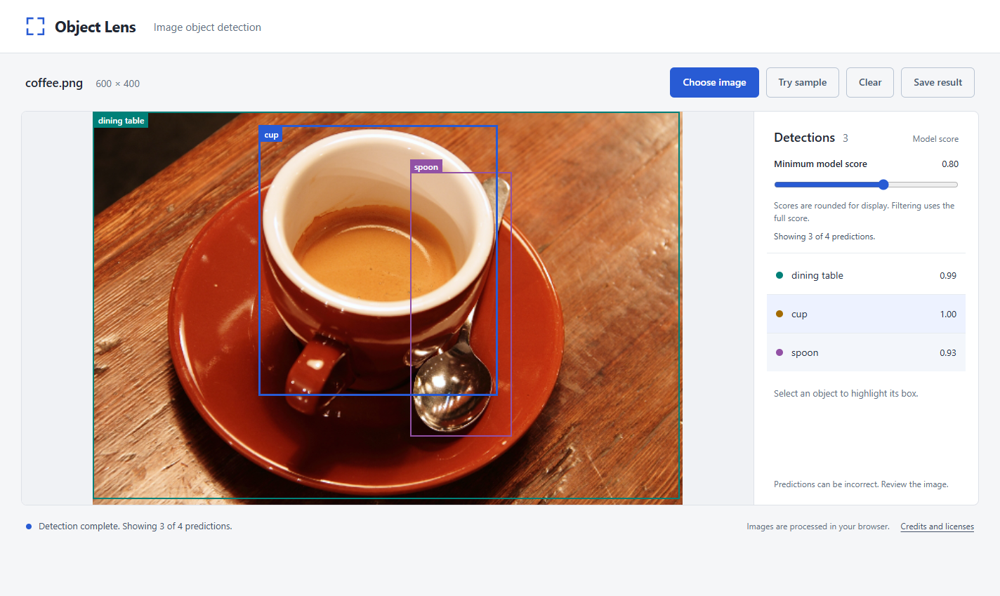
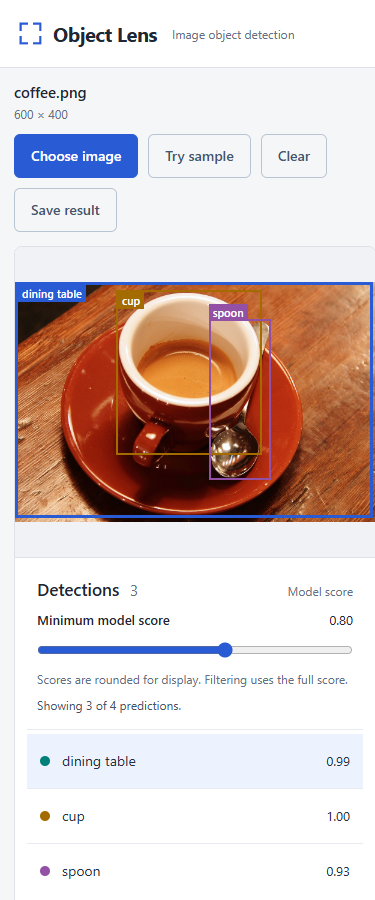

# Object Lens

[](https://github.com/lejie710/object-lens/actions/workflows/ci.yml)

A browser object detector built to be tested: stale results, slow model downloads, malformed model output and recovery.

**Showcase:** [lejie710.github.io/object-lens](https://lejie710.github.io/object-lens/) | **Status:** complete (version 1.0), not under active development



## The question

When someone tries a browser object detector on their own photos, switching images quickly, on a slow connection, or when the model returns something broken, can the page show results that belong to a different photo, misplace boxes, or get stuck with no way to recover?

Object Lens is a small browser app that runs a pretrained DETR object detector on your photo, entirely on your own machine. Its Python, pytest and Selenium suite answers the question with three kinds of evidence: a controlled test for each failure, every core rule caught when it is broken on purpose, and a before/after measurement on a slow connection.

## The answer, with evidence

| Evidence | Result |
| --- | --- |
| Model download throttled to 2.5 Mbps on loopback | Before: loading failed at 121 s with 37.4 of 43.1 MB (86%) received, and Try again restarted from zero. After: the package received every byte and reached ready at 140.6 s ([slow-transfer-2-5-mbps.json](docs/evidence/slow-transfer-2-5-mbps.json)) |
| Recorded full suite | 104 passed, with 0 failures, errors or skips: 100 controlled cases and 4 real-model cases ([summary](docs/evidence/v1-0-2-verification.json), [JUnit XML](docs/evidence/v1-0-2-full-suite.xml)) |
| Core rules broken on purpose | Every core rule the question depends on has at least one test that fails when the rule is broken ([v1-0-2-sensitivity.json](docs/evidence/v1-0-2-sensitivity.json)) |

The question, its measure, the acceptance examples, the ranked risks and the design decisions are in [DESIGN.md](docs/DESIGN.md#the-question).

## Limits

What Object Lens deliberately does not do, and why ([non-goals and rabbit holes](docs/DESIGN.md#non-goals-and-rabbit-holes)):

- **Model training or accuracy evaluation.** The tests check how the app handles model output, not whether the model is accurate. Nothing here measures accuracy, precision or recall.
- **Accounts, upload records or image history.** The app handles one image at a time and photos never leave the browser, so nothing needs storing.
- **A hosted inference API or cloud deployment.** The model runs locally in the user's browser. The showcase is the same static package served as plain files; no server runs the model.
- **Other browsers and mobile.** Only Windows and Chrome were verified, which keeps the scope small enough to test thoroughly.
- **Resumable model download.** Try again restarts the download from zero. Resuming would require changing the underlying library.

Known risks that are not tested:

- **Repeated 45 s stalls.** Try again restarts from zero, so a connection that keeps stalling for 45 s cannot load the detector (non-goal 5).
- **Other browsers and mobile** (non-goal 4).
- **Large real phone photos with EXIF rotation.** Only synthetic images and small public photos are tested.

Other limits of the evidence:

- CI runs the 100 controlled tests on GitHub Actions (`windows-latest`). The 4 real-model tests run locally only: on a hosted runner the same pinned model gives slightly different scores and boxes than the recorded references ([details](docs/DEFECTS.md#real-model-references-hold-only-on-the-recording-machine)). Results of hosted runs are not recorded in this repository. The recorded results all come from one local Windows and Chrome environment.
- The real-model checks compare against earlier output from the same pinned model. They show regression, not accuracy.
- The announcement tests inspect how the page is configured. Nobody has tested it with an actual screen reader, and there is no accessibility certification.
- A single full run does not measure a flake rate.

The full release assessment is in [VERIFICATION.md](docs/VERIFICATION.md).

## What the app does

You choose a photo or click **Try sample**. The app shows the predicted labels and boxes, and you can select one to highlight it. A minimum model score slider (0.50 to 1.00) hides or restores predictions. **Save result** downloads the photo with its visible boxes at the original dimensions. Filtering and saving reuse the existing result, so the model does not run again.

The model runs in a web worker using Transformers.js 2.17.2 and ONNX Runtime Web on the CPU (WASM). A small Python server only serves the files. Object Lens adapts Hugging Face's object-detection example and uses a pretrained model as it is. It does not train a model.

## What it looks like

<p>
  
  
</p>

At a minimum score of 0.80 the filter hides the spoon scored 0.67 and keeps the other three predictions, without running the model again. At 390 pixels wide (the top of the page is shown) the photo stacks above the list and keeps the same 3 of 4 result. **Save result** at this setting produced [export.png](docs/screenshots/app/export.png), the 600 x 400 photo with the three visible boxes and their scores drawn on it. The [walkthrough](docs/WALKTHROUGH.md) goes through every screen in order and shows the model on the other sample photos, including a wrong guess and a photo with nothing it recognises.


The model runs inside the browser and the Python server only serves files; the tests drive that same page in headless Chrome.

## How it is tested

| Level | Tool | Example |
| --- | --- | --- |
| Controlled browser tests | pytest, Selenium, headless Chrome, a scripted test worker in place of the model | a hang, a stall or a malformed result on demand; an old image's result cannot repaint a newer image |
| Real-model regression (marked `inference`) | pytest with the pinned DETR model | labels, scores and box position on three public photos compared with earlier recorded output from the same model |
| Static package under a subpath | an ordinary Python static server at `/object-lens/` | sample, filter and export with the real model from the built package |
| Deliberate faults | [`tools/check_review_sensitivity.py`](tools/check_review_sensitivity.py), in throwaway copies | each planted fault must make its intended tests fail |
| Harness and package unit checks | pytest, no browser | the package matches its allowlist; the link-preview tags name a packaged image of the declared size; shared assertion helpers say which check failed; the harness still closes the browser when setup fails |
| CI | GitHub Actions on `windows-latest`, pip-audit | controlled tests on every push to `main` and every pull request; locked dependencies audited ([ci.yml](.github/workflows/ci.yml)) |

The recorded run took 737.837 s of JUnit suite time on Windows 11, Chrome 156.0.8078.80, Python 3.12.10, pytest 9.0.3 and Selenium 4.40.0. A local audit of `requirements-lock.txt` found 0 known vulnerabilities in 30 packages ([pip-audit.json](docs/evidence/security/pip-audit.json)). The count per module and the risk each one covers are in the [test mix](docs/DESIGN.md#risks-and-test-mix), and each [acceptance example](docs/DESIGN.md#acceptance-examples) names the tests that check it.

### Do the tests catch real faults?

The sensitivity check plants one deliberate fault in each throwaway copy of the app and never changes the checkout itself. A **30-case clean control** passes first. Each of the **16 faults** then makes its intended tests fail, giving **28 intended failures** in total ([v1-0-2-sensitivity.json](docs/evidence/v1-0-2-sensitivity.json)). Five of the faults each break one of the core rules the question depends on:

| Core rule | Deliberate change | Test that failed |
| --- | --- | --- |
| A file of exactly 10 MiB is accepted | `file.size > MAX_BYTES` becomes `>=` | `tests/test_ui.py::test_file_size_boundary[10485760-complete]` (the 10 MiB + 1 byte case still passes) |
| The filter keeps a score equal to the minimum | `score >= minimum` becomes `>` | 3 of 7 in `tests/test_filter.py`: `test_exact_minimum_filters_underlying_scores_and_restores_without_inference`, `test_filter_preserves_result_identity_color_and_surviving_selection`, `test_hidden_predictions_can_be_restored_and_differ_from_no_model_predictions` |
| An old image's result cannot repaint a newer image or a cleared workspace | The guard `data.id === revision && currentImage?.id === revision` becomes `true` | `tests/test_ui.py::test_replacing_a_processing_image_discards_the_old_result[slow-car.png]`, `tests/test_ui.py::test_clearing_a_processing_image_prevents_late_repaint` |
| An outdated export cannot download | The check after PNG encoding is removed | All 3 cases of `tests/test_export.py::test_changed_result_cancels_a_png_still_being_encoded` |
| A late sample cannot replace a newer image or undo Clear | All three defences are removed: the fetch abort, the check after the download, and the reserved revision | Both cases of `tests/test_sample.py::test_late_sample_response_cannot_override_a_later_user_action` |

One more fault is recorded as an equivalent fault. Removing only the check after the sample download changes nothing observable, because the fetch abort and the reserved revision still stop the late sample, so its 2 cases are expected to pass and do. That is why the late-sample fault removes all three defences. The other 11 faults, which target visible output, loading deadlines and result validation, account for the remaining 17 intended failures; each is listed with the module that caught it and its failure count in [Core rules broken on purpose](docs/VERIFICATION.md#core-rules-broken-on-purpose). This shows that the selected checks detect the selected faults. It is not a mutation score.

### One defect, end to end: the model could not load on a slow connection

- **What failed:** on the throttled connection in the evidence table, loading stopped with "The detection model took too long to load".
- **How it was detected:** an independent review ran a paced loopback probe against the package.
- **Impact:** Try again restarted from zero, so at that speed the detector could never be used.
- **Cause:** one fixed 120 s loading deadline that ignored download progress, so a slow but steady download was treated as a dead one.
- **Test that prevents it:** the download now fails only after 45 s with no loading event, and start-up after the last byte has its own 120 s deadline; four tests in `tests/test_recovery.py` and three planted faults guard this; all four tests are listed in [Model loading on slow or stalled connections](docs/VERIFICATION.md#model-loading-on-slow-or-stalled-connections).

The full entry, and every other confirmed defect in the same five parts, is in [Defects and corrections](docs/DEFECTS.md#slow-connections-could-never-load-the-model), with the completed-download case in [the entry that follows it](docs/DEFECTS.md#a-completed-download-could-be-reported-as-a-stalled-connection).

## Run it

Windows PowerShell, Python 3.12 and Google Chrome. The first setup needs internet access for the Python packages, the Chrome driver, the browser runtime and the model files. No paid API is needed.

```powershell
git clone https://github.com/lejie710/object-lens.git
cd object-lens
py -3.12 -m venv .venv
.\.venv\Scripts\python.exe -m pip install -r requirements-lock.txt
.\.venv\Scripts\python.exe tools/prepare_assets.py
.\.venv\Scripts\python.exe tools/download_samples.py
.\.venv\Scripts\python.exe tools/browser_check.py
.\.venv\Scripts\python.exe serve.py
```

Or skip setup and use the [showcase](https://lejie710.github.io/object-lens/) in Chrome on Windows, the only verified browser and platform. Its first visit downloads more than 50 MB of model and runtime files (the model alone is 43 MB), and the photo you choose stays in your browser. Locally, open `http://127.0.0.1:8765` in Chrome. To try it: click **Try sample**, select the cup, move **Minimum model score** from 0.50 to 0.80, and click **Save result**. Then lower the filter again to bring the hidden predictions back. Predictions can include mistakes or duplicates, and a score does not guarantee the prediction is right.

## Test it

```powershell
.\.venv\Scripts\python.exe -m pytest                       # full suite
.\.venv\Scripts\python.exe -m pytest -m "not inference"    # controlled checks; not evidence about the model
.\.venv\Scripts\python.exe -m pytest -m inference          # real model: three photos plus the static package
```

The tests start and stop their own local servers and use headless Chrome, so `serve.py` does not need to be running. Checking prepared files offline, the lock files, recording evidence, troubleshooting and the repository layout are in [OPERATIONS.md](docs/OPERATIONS.md).

## Read next

| Document | Contents |
| --- | --- |
| [Walkthrough](docs/WALKTHROUGH.md) | Every screen of the app in order, including the controlled timeout screens |
| [Design](docs/DESIGN.md) | The question, acceptance examples, ranked risks, test mix and decisions |
| [Verification](docs/VERIFICATION.md) | Evidence for each behaviour, every planted fault, the testing workflow and the release assessment |
| [Defects](docs/DEFECTS.md) | Every confirmed defect: what failed, how it was found, impact, cause and the test that prevents it |
| [Operations](docs/OPERATIONS.md) | Setup detail, running, testing, recording evidence, troubleshooting and repository layout |
| [Evidence index](docs/evidence/README.md) | What each recorded result file contains |
| Diagrams | The [runtime architecture](docs/diagrams/runtime-architecture.png) and the [image sequence](docs/diagrams/image-sequence.png) |
| [Image sources](docs/IMAGE_SOURCES.md) | Where each sample photo comes from and the objects expected in it |
| [Security](SECURITY.md) | Security scope and reporting |

## Credits and licences

Adapted from Hugging Face's Transformers.js object-detection tutorial (Apache-2.0), kept in [`baseline/upstream`](baseline/upstream/README.md). The model is [facebook/detr-resnet-50](https://huggingface.co/facebook/detr-resnet-50) through [Xenova/detr-resnet-50](https://huggingface.co/Xenova/detr-resnet-50), and the sample photos come from scikit-image. Every library, licence and photo credit is in [NOTICE.md](NOTICE.md). Object Lens is copyright 2026 Le Jie Tan and licensed under the [Apache License 2.0](LICENSE).
