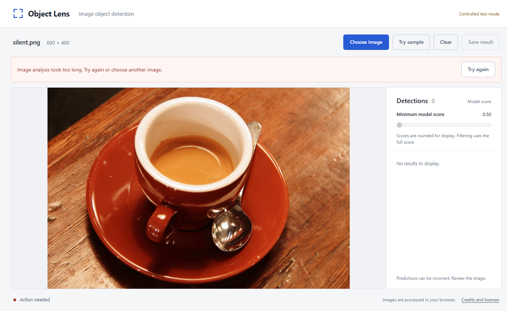
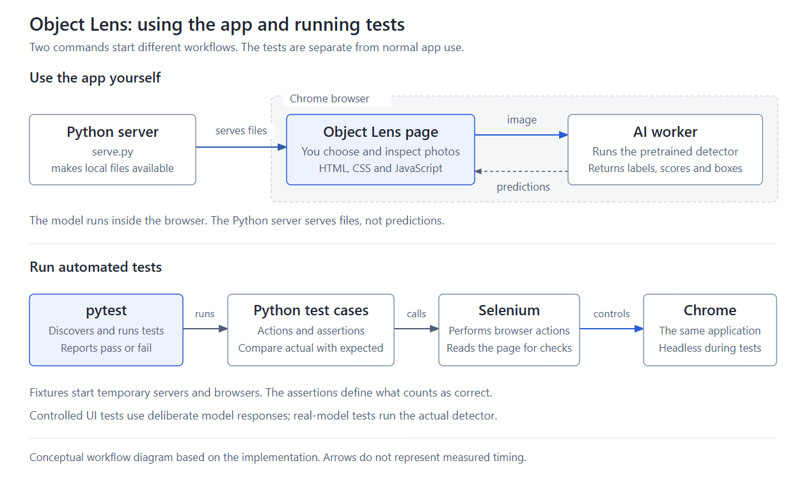
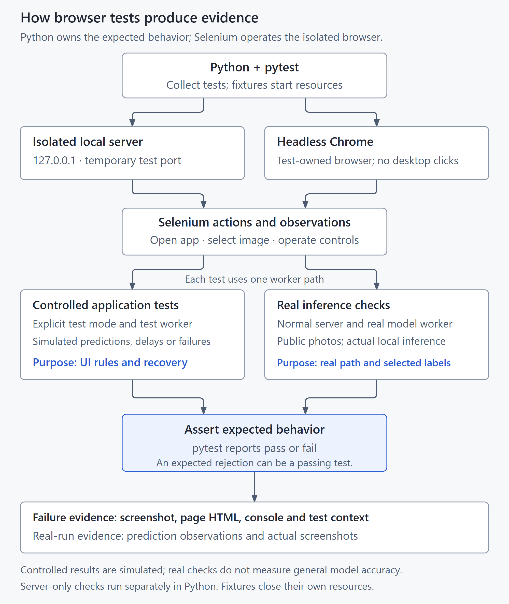

# Object Lens

Object Lens is a small browser app that runs a pretrained DETR object detector on your photo, entirely on your own machine. It comes with a Python, pytest and Selenium suite aimed at specific risks: stale results, broken recovery, misplaced boxes and loading failures.

| Real detection on the sample photo | Score filter applied | Controlled analysis timeout |
| --- | --- | --- |
| [](docs/screenshots/review-followup/desktop.png) | [](docs/screenshots/review-followup/filtered.png) | [](docs/screenshots/review-followup/timeout.png) |

The first two screenshots show the real model running on the public coffee sample. The third shows an image-analysis timeout that a test triggers on purpose with a controlled worker. It is not a model result. The screenshot after Clear shows the workspace emptied, with a prompt to restart the detector with Try again ([timeout-cleared.png](docs/screenshots/review-followup/timeout-cleared.png)).

## What the app does

You choose a photo or click **Try sample**. The app shows the predicted labels and boxes, and you can select one to highlight it. A minimum model score slider (0.50 to 1.00) hides or restores predictions. **Save result** downloads the photo with its visible boxes at the original dimensions. Filtering and saving reuse the existing result, so the model does not run again.

The model runs in a web worker using Transformers.js 2.17.2 and ONNX Runtime Web on the CPU (WASM). A small Python server only serves the files. Object Lens adapts Hugging Face's object-detection example and uses a pretrained model as it is. It does not train a model.

## How it is tested

**Recorded full run: 102 passed, with 0 failures, errors or skips.** That is 98 controlled cases and 4 real-model cases, taking 780.398 s of JUnit suite time. The run used Windows, Chrome 156.0.8078.80, Python 3.12.10, pytest 9.0.3 and Selenium 4.40.0. Records: [summary](docs/evidence/branch-review-verification.json) and [JUnit XML](docs/evidence/branch-review-full-suite.xml).

The tests use two kinds of check, and each answers a different question:

- **Controlled tests (98)** swap the model for a scripted test worker. It returns exact predictions, empty results, malformed responses, hangs and stalls on demand. The tests check app state, race conditions and recovery against fixture values that were defined separately from the app.
- **Real-model tests (4, marked `inference`)** run the actual pinned model. Three of them use three public photos and compare each visible row's label and score, and the position of the target object's box, with earlier recorded output from the same model. That catches regressions. It does not prove the predictions are correct. The fourth runs the sample, filter and export workflow through the static package.

| Test module | Cases | What it protects |
| --- | ---: | --- |
| `test_recovery.py` | 26 | Deadlines, telling a stalled model download from a slow but steady one, rejecting a malformed result as a whole, and recovery through Clear and Try again |
| `test_ui.py` | 25 | Boxes and list match the current image, stale results cannot repaint after the image is replaced or cleared, file size and pixel limits, focus, announcement settings, narrow layout |
| `test_public_package.py` | 11 | The static package contains only allowlisted files and runs on an ordinary static server (1 case uses the real model) |
| `test_export.py` | 8 | The downloaded PNG has the original dimensions and only the visible predictions, and a pending export cannot download after Clear |
| `test_filter.py` | 7 | The score filter keeps boxes, list and counts in agreement and restores hidden predictions without rerunning the model |
| `test_sample.py` | 7 | Try sample uses the real app path, and missing or slow sample data can be recovered from |
| `test_startup.py` | 6 | Startup races and held configuration responses, using real local HTTP |
| `test_loading.py` | 5 | Startup feedback for configuration, download, unknown progress and readiness |
| `test_inference.py` | 3 | Real model on three photos: visible labels and scores, and box position compared with earlier recorded output |
| `test_harness_cleanup.py` | 3 | The test harness still closes the browser when timeout setup fails or when it cannot save failure evidence |
| `test_server.py` | 1 | The normal server cannot serve controlled test predictions |

The tests are organised around eleven risk-based acceptance criteria, AC1 to AC11, in [DESIGN.md](docs/DESIGN.md). The table linking each criterion to its evidence is in [VERIFICATION.md](docs/VERIFICATION.md).

### Do the tests catch real faults?

[`tools/check_review_sensitivity.py`](tools/check_review_sensitivity.py) copies the app into throwaway folders and plants one deliberate fault in each copy. It never changes the checkout itself. A **13-case clean control** passes first. Each of the **11 faults** then makes its targeted assertions fail, giving **17 intended failures** in total. Record: [branch-review-sensitivity.json](docs/evidence/branch-review-sensitivity.json).

| Fault planted | Caught by | Failures |
| --- | --- | ---: |
| Visible labels blanked | `test_ui.py` | 1 |
| Visible scores blanked, numeric metadata kept | `test_ui.py` | 2 |
| Rendered boxes moved out of position | `test_inference.py` | 3 |
| Status, live-region and alert settings removed | `test_ui.py` | 1 |
| Fixed load deadline that ignores progress | `test_recovery.py` | 1 |
| Later settings-file events keep extending initialization | `test_recovery.py` | 1 |
| Blank-label rejection removed | `test_recovery.py` | 2 |
| Every score scaled by 0.95 | `test_inference.py` | 3 |
| Every score forced to 1.0 | `test_inference.py` | 1 |
| Completed download still timed by the stall window | `test_recovery.py` | 1 |
| A cleared hang reported as an analysis failure | `test_recovery.py` | 1 |

The two score faults also change the page's own data attributes, so among the real-model checks only the comparison with the recorded output catches them. This shows that the selected checks detect the selected faults. It is not a mutation score.

### One defect, end to end: the model could not load on a slow connection

| Step | What happened |
| --- | --- |
| Symptom | A probe throttled only the 43.1 MB model download to 2.5 Mbps on loopback. After 121 s the app showed "The detection model took too long to load", with 37.4 of 43.1 MB received (86%). Try again restarted the download from zero, so at this speed retrying could never succeed. |
| Cause | Model loading had one fixed 120 s deadline, counted from worker start. It ignored download progress, so a slow but steady download was treated the same as a dead one. |
| Fix | The download now fails only after 45 s with no loading event, and each event restarts that 45 s window. Once all the bytes have arrived, model start-up gets its own fixed 120 s deadline, which later events cannot extend. The error messages now say which stage stalled. |
| Verification | Under the same 2.5 Mbps probe, the current package received every byte and reached ready at 140.6 s ([branch-review-slow-transfer.json](docs/evidence/branch-review-slow-transfer.json)). Controlled tests cover a stalled download, a slow steady download that must not time out, and a hung start-up. Three of the planted faults above now guard this behaviour. |

Each condition was run once, on loopback. That is not a measurement of Internet speed. The full write-up of every confirmed finding is in [SOURCE_REVIEW.md](docs/SOURCE_REVIEW.md).

### What is not claimed

- Only the recorded Windows and Chrome environment was checked. There is no CI yet, no deployed URL, and no testing on other browsers or mobile.
- The real-model checks compare against earlier output from the same pinned model. Nothing here measures accuracy, precision or recall.
- The announcement tests inspect how the page is configured. Nobody has tested it with an actual screen reader, and there is no accessibility certification.
- A single full run does not measure a flake rate. Try again still restarts the model download from the beginning, so a connection that keeps stalling for 45 s cannot load the detector.

The full release assessment is in [VERIFICATION.md](docs/VERIFICATION.md).



## First setup

Start in the folder where you cloned the repository. The target environment is Python 3.12 with Chrome. The first setup needs internet access to download the Python packages, the Chrome driver, the browser runtime, the model files and the public sample photos. No paid API is needed.

```powershell
py -3.12 -m venv .venv
.\.venv\Scripts\python.exe -m pip install -r requirements-lock.txt
.\.venv\Scripts\python.exe tools/prepare_assets.py
.\.venv\Scripts\python.exe tools/download_samples.py
.\.venv\Scripts\python.exe tools/browser_check.py
```

`requirements.txt` lists the direct dependencies, and `requirements-lock.txt` records the full tested environment. The model and runtime files go into `dist/assets`, which is kept out of Git. Their pinned sources and SHA-256 hashes are in `asset-lock.json`. To check the prepared files without downloading anything:

```powershell
.\.venv\Scripts\python.exe tools/prepare_assets.py --verify-only
.\.venv\Scripts\python.exe tools/download_samples.py --verify
```

If the app reports a missing file, run the asset preparation step again, then click **Try again** in the app.

## Run locally

```powershell
.\.venv\Scripts\python.exe serve.py
```

Open `http://127.0.0.1:8765` in Chrome. The server is reachable only from this computer, and Ctrl+C stops it. If port 8765 is already in use, run `serve.py --port 8766` and open port 8766 instead.

To try it: click **Try sample**, select the cup, move **Minimum model score** from 0.50 to 0.80, and click **Save result**. Then lower the filter again to bring the hidden predictions back. Predictions can include mistakes or duplicates, and a score does not guarantee the prediction is right.

## Run the tests

The tests start and stop their own local servers and use headless Chrome, so `serve.py` does not need to be running.

```powershell
# Full suite
.\.venv\Scripts\python.exe -m pytest

# Controlled app, server, package and harness checks; not evidence about the model
.\.venv\Scripts\python.exe -m pytest -m "not inference"

# Real model: three photo regression checks plus the static-package workflow
.\.venv\Scripts\python.exe -m pytest -m inference
```

The static-package test serves the prepared site from an ordinary local static server. It does not mean the app has been deployed to a public URL.



## More screenshots

[Empty state](docs/screenshots/review-followup/empty.png), [filter hides every prediction](docs/screenshots/review-followup/filtered-empty.png), [exported PNG](docs/screenshots/review-followup/export.png), [input error](docs/screenshots/review-followup/error.png), [timeout after Clear](docs/screenshots/review-followup/timeout-cleared.png), and the layout at widths of [320](docs/screenshots/review-followup/width-320.png), [390](docs/screenshots/review-followup/width-390.png), [768](docs/screenshots/review-followup/width-768.png) and [1440](docs/screenshots/review-followup/width-1440.png) px. The input error comes from the real app with a deliberately unsupported file. The two timeout screens come from the controlled test worker.

## Read next

- [Design and acceptance criteria](docs/DESIGN.md)
- [Verification and release assessment](docs/VERIFICATION.md)
- [Defects found and how they were fixed](docs/SOURCE_REVIEW.md)
- [Short guide to the stack and one test](docs/LEARNING.md)
- [Evidence index](docs/evidence/README.md)
- [System design PDF](docs/system-design/Object_Lens_System_Design.pdf), with diagrams of the [runtime architecture](docs/system-design/diagrams/runtime-architecture.png) and the [image sequence](docs/system-design/diagrams/image-sequence.png)
- [Image sources and the objects expected in each photo](docs/IMAGE_SOURCES.md)

## Which folders matter

| Folder | Purpose |
| --- | --- |
| `dist` | The app and its prepared local assets |
| `tests` | The pytest and Selenium suite, plus the controlled worker fixture |
| `tools` | Helpers for setup, packaging, collecting evidence and checking fault sensitivity |
| `docs` | Design, verification evidence, screenshots and diagrams |
| `baseline` | The original upstream example, kept for attribution and comparison |
| `.venv`, `.local`, `artifacts` | Generated locally and ignored by Git: the Python environment, the driver cache and local verification copies, and raw test outputs; not part of the app |

## Credits and licences

- Adapted from Hugging Face's Transformers.js vanilla JavaScript object-detection tutorial (Apache-2.0). The original is kept in [`baseline/upstream`](baseline/upstream/README.md), and its revision and checksums are in `baseline/source.json`.
- Model: [facebook/detr-resnet-50](https://huggingface.co/facebook/detr-resnet-50) (the model card states Apache-2.0), used through the browser-compatible conversion [Xenova/detr-resnet-50](https://huggingface.co/Xenova/detr-resnet-50) at the revision pinned in `asset-lock.json`.
- Runtime: [Transformers.js](https://github.com/huggingface/transformers.js) 2.17.2 (Apache-2.0), [ONNX Runtime Web](https://github.com/microsoft/onnxruntime) 1.14.0 (MIT) and [@huggingface/jinja](https://www.npmjs.com/package/@huggingface/jinja) 0.2.2 (MIT).
- Sample photos: unchanged copies from scikit-image v0.25.2. Each is public domain or CC0, and the creators are credited in [IMAGE_SOURCES.md](docs/IMAGE_SOURCES.md).

[NOTICE.md](NOTICE.md) has the full attribution. The project is licensed under the [Apache License 2.0](LICENSE).
