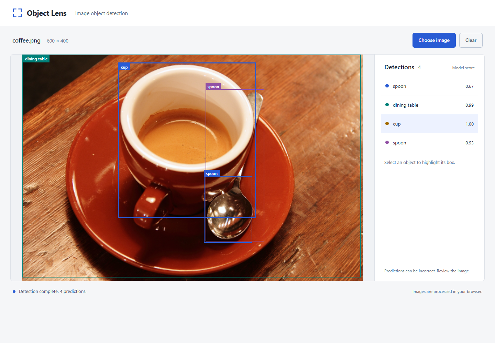

# Object Lens

A small local web application for exploring pretrained object detection, with Python, pytest and Selenium tests for its behavior.

Developed with assistance from AI tools.



## What it does

Choose a photo, inspect predicted labels and boxes, highlight a result, then replace or clear the image. Object Lens focuses on a readable interface and reliable state handling. It adapts Hugging Face's educational object-detection example and uses a pretrained model; it does not train a model or detect semiconductor manufacturing defects.

## Run locally

From this project directory in PowerShell:

```powershell
Set-Location '%USERPROFILE%\Downloads\Apple-SDET\object-lens'
.\.venv\Scripts\python.exe serve.py
```

Open `http://127.0.0.1:8765` in Chrome. Keep that terminal open while using the app; stop the server with Ctrl+C. The application binds only to this computer. You do not need to activate the virtual environment.

If you move the project, use its new location in `Set-Location`. If port 8765 is already in use, run `serve.py --port 8766` and open `http://127.0.0.1:8766` instead.

For a first demonstration, choose `dist\samples\coffee.png`, select the cup result, then replace it with `dist\samples\chelsea.png`. Model predictions can contain mistakes or duplicates. The score is not an accuracy guarantee.

## Run the tests

```powershell
.\.venv\Scripts\python.exe -m pytest
```

Tests start and stop their own local servers and use headless Chrome. You do not need to start `serve.py` first. Controlled UI tests are separate from tests marked `inference`, which use the actual local model. See [verification and release assessment](docs/VERIFICATION.md) for results and limitations.

If your first terminal is still running the app, open a second PowerShell window in this project directory for tests, or stop that server with Ctrl+C first.

For a shorter run while learning one part:

```powershell
# Application behavior with controlled model responses; not AI accuracy evidence.
.\.venv\Scripts\python.exe -m pytest -m "not inference"

# Actual model execution on three public sample photos.
.\.venv\Scripts\python.exe -m pytest -m inference
```

## Environment setup

Python 3.12 and Chrome are the target environment. An initial internet connection is needed for Python packages, the Chrome driver, the browser AI runtime, model files and public sample photos. Downloads have recorded sources. No paid API is required.

```powershell
py -3.12 -m venv .venv
.\.venv\Scripts\python.exe -m pip install -r requirements-lock.txt
.\.venv\Scripts\python.exe tools/prepare_assets.py
.\.venv\Scripts\python.exe tools/download_samples.py
.\.venv\Scripts\python.exe tools/browser_check.py
```

The direct dependencies are listed in `requirements.txt`; `requirements-lock.txt` records the full tested Python environment. The model/runtime files live in `dist/assets` and are excluded from Git. Their pinned sources and SHA-256 hashes are recorded in `asset-lock.json`. Verify prepared assets without downloading:

```powershell
.\.venv\Scripts\python.exe tools/prepare_assets.py --verify-only
.\.venv\Scripts\python.exe tools/download_samples.py --verify
```

If the app cannot prepare detection because an asset is missing, run the asset preparation again and use Try again in the app. Normal prepared-app inference uses local assets; Selenium may need network access again if Chrome updates and its matching driver is not cached.

## Read next

- [Design and acceptance criteria](docs/DESIGN.md)
- [A short guide to the stack and one test](docs/LEARNING.md)
- [Verification and release assessment](docs/VERIFICATION.md)
- [Image sources and expected visible objects](docs/IMAGE_SOURCES.md)
- [The original upstream example](baseline/upstream/README.md)
- [Attribution and baseline interpretation](NOTICE.md)
- [Approved design concept and its provenance](docs/design/README.md)

The core automation language is Python. Selenium operates the browser; pytest executes the tests and reports assertions. JavaScript remains the application language.

## Which folders matter

| Folder | Purpose |
| --- | --- |
| `dist` | The maintained application and its prepared local assets |
| `tests` | The Python checks to read and modify while learning |
| `docs` | Design, learning notes and verification evidence |
| `tools` | Small setup and evidence-collection helpers |
| `baseline` | Preserved upstream source for attribution and comparison |
| `.venv`, `.local`, `artifacts` | Generated environment, driver/verification copies and raw outputs; not additional applications to maintain |
