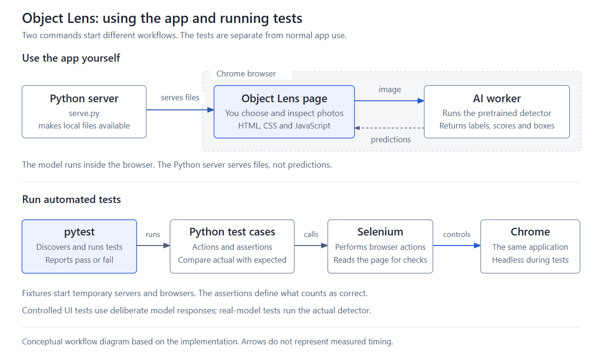

# Object Lens

Object Lens is a small local browser application for trying object detection on a photo. Its intended user is a developer, QA engineer or learner exploring a pretrained detector. This is a practical way to explore Python, pytest, Selenium and an AI-enabled web interface. It is not a semiconductor defect detector or an established commercial product.

The application scope is one image at a time, one fixed model and Chrome on Windows. The interface follows the design concept: a light background, large photograph, compact results list and essential controls. The app can be served as a static site; see [Public demo package](PUBLIC_DEMO.md) for the package and hosting status.

## The question

When someone tries a browser object detector on their own photos, switching images quickly, on a slow connection, or when the model returns something broken, can the page show results that belong to a different photo, misplace boxes, or get stuck with no way to recover?

Measure: a controlled test for each of those failures, every core rule the answer depends on caught when broken on purpose, and a model download throttled to 2.5 Mbps compared with a fixed loading deadline and with stall-based loading.

Result: each failure has a controlled test, the suite has 102 tests, and every core rule made at least one test fail when it was broken on purpose ([Core rules broken on purpose](VERIFICATION.md#core-rules-broken-on-purpose)). At 2.5 Mbps, a fixed 120-second deadline failed at 121 s with 86% of the model received; the stall-based loading reached ready at 140.6 s ([branch-review-slow-transfer.json](evidence/branch-review-slow-transfer.json)).

Scope the answer holds for: Windows with Chrome, one image at a time, the pinned model (Transformers.js 2.17.2 with a quantized DETR model), synthetic test images and small public photos. Failure cases use a controlled test worker; four tests run the real model. The answer says nothing about how accurate the model is.

## Non-goals and rabbit holes

Non-goals, each with its reason:

| Non-goal | Reason |
| --- | --- |
| Model training or accuracy evaluation | The tests check how the app handles model output, not whether the model is accurate. |
| Accounts, upload records or image history | One image at a time, and photos never leave the browser, so nothing needs storing. |
| Hosted inference API or cloud deployment | The model runs locally in the user's browser. |
| Other browsers and mobile | Verified only on Windows with Chrome; the scope is kept small enough to test thoroughly. |
| Resumable model download | Try again restarts from zero; resuming would require changing the underlying library. |

The application also has no camera, video, batch processing, model picker or GPU tuning; these follow from the one-image, one-model scope.

Rabbit holes, and the decision that removed each:

| Rabbit hole | Decision that removed it |
| --- | --- |
| Upgrading to Transformers.js v3 | Stay pinned at 2.17.2 ([D1](#decisions)). |
| Hand-made ground-truth boxes for the real-model checks | Compare with the pinned model's own recorded output and call it regression, not accuracy ([D2](#decisions)). |
| Making a slow-network download reliable | A stall watchdog that asks "is it still moving?" instead of a fixed deadline, with no resume ([D3](#decisions)). |

## Acceptance examples

Each example is one concrete case of an acceptance criterion. "Traces to" names the part of [the question](#the-question) it answers; criteria marked "supporting" keep the app usable but are not part of the question itself. Test names are `tests/file::function`. The three tests in `test_harness_cleanup.py` check the test harness itself (browsers close when failure-evidence capture fails) and map to no criterion.

**AC1 Input limits.** Given a valid PNG of exactly 10 MiB (10,485,760 bytes), when the user selects it, then it is analysed and its predictions appear; given the same image one byte larger, then the page shows an error naming the 10 MiB limit and asking for a smaller JPEG or PNG, and shows no predictions. The same holds for decoded size: 4000 × 4000 pixels is analysed, 4001 × 4000 is rejected with a message about 16 megapixels. Unsupported, unreadable or truncated files are rejected, and the next valid image is analysed. Traces to: stuck with no way to recover (an oversized photo must not freeze the tab). Tests: `tests/test_ui.py::test_file_size_boundary`, `tests/test_ui.py::test_decoded_pixel_boundary`, `tests/test_ui.py::test_invalid_input_is_rejected_and_valid_input_recovers`, `tests/test_ui.py::test_truncated_png_body_is_rejected_and_recovers`, `tests/test_ui.py::test_real_jpeg_input_is_accepted`.

**AC2 Results match the current image.** Given a photo for which the model returns laptop (0.97) and cup (0.91), when analysis completes, then the list shows exactly "laptop 0.97" and "cup 0.91", each with one labelled box, and the laptop box sits at the returned coordinates scaled to the displayed image within 2 CSS pixels. A JPEG with an EXIF rotation is displayed upright and its boxes stay aligned. Traces to: misplaced boxes. Tests: `tests/test_ui.py::test_predictions_and_boxes_match_the_current_image`, `tests/test_ui.py::test_visible_scores_round_without_changing_the_underlying_values`, `tests/test_ui.py::test_jpeg_exif_orientation_preserves_display_and_box_alignment`, `tests/test_ui.py::test_replacing_image_replaces_all_results`, `tests/test_inference.py::test_real_model_detects_reviewed_object`.

**AC3 Selection and Clear.** Given a completed result with laptop and cup, when the user selects the cup entry, then exactly one box is highlighted and it is the cup box. Given a completed result, when the user reaches Clear with the keyboard and presses Enter, then the image, boxes and list are removed. Given a cleared file, when the user selects the same file again, then it is analysed again. Traces to: supporting. Tests: `tests/test_ui.py::test_selecting_a_result_highlights_its_box`, `tests/test_ui.py::test_clear_is_reachable_and_usable_with_keyboard`, `tests/test_ui.py::test_unicode_filename_and_reselecting_same_file`.

**AC4 An old result cannot repaint.** Given a photo of a dog that is still being analysed, when the user selects a photo of a car before the dog result arrives, then "dog" never appears, not even briefly, and only "car" is shown after the dog result would have arrived; when the user presses Clear instead, then the workspace stays empty. Traces to: results that belong to a different photo. Tests: `tests/test_ui.py::test_replacing_a_processing_image_discards_the_old_result`, `tests/test_ui.py::test_clearing_a_processing_image_prevents_late_repaint`, `tests/test_filter.py::test_new_image_and_clear_reset_filter_and_retire_old_cached_predictions`.

**AC5 Failures are visible and recoverable.** Given a photo for which the model returns no predictions, when analysis finishes, then the photo stays visible with an explanation and no error; given a photo whose analysis fails, returns malformed output, never answers or crashes the worker, then the page shows a message saying what failed with Try again, shows no partial predictions, and the next valid image or Try again produces a correct result. A box partly outside the image is clamped to the image edge rather than rejected. Traces to: stuck with no way to recover, and misplaced boxes. Tests: `tests/test_ui.py::test_empty_predictions_are_not_an_error`, `tests/test_ui.py::test_processing_failure_is_visible_and_next_image_recovers`, `tests/test_ui.py::test_worker_start_failure_can_be_retried`, `tests/test_ui.py::test_nonresponding_worker_times_out_and_retries_the_latest_image`, `tests/test_recovery.py::test_malformed_result_is_rejected_without_partial_detections_and_recovers` (16 kinds of malformed output), `tests/test_recovery.py::test_retry_after_a_transient_invalid_result_reanalyzes_the_same_image`, `tests/test_recovery.py::test_inference_timeout_clear_and_retry_describe_detector_availability`, `tests/test_recovery.py::test_worker_crash_during_inference_is_not_described_as_startup_failure`, `tests/test_recovery.py::test_clear_during_a_hung_analysis_restarts_quietly`, `tests/test_recovery.py::test_partially_outside_box_is_clamped_to_the_rendered_image`.

**AC6 Keyboard, announcements and narrow screens.** Given a completed result, when the user tabs through the page, then Clear, Try sample and the minimum-score control are reachable, the minimum-score control shows a visible focus outline, and Enter activates the buttons; status regions carry `role="status"` with polite, atomic announcements and the error carries `role="alert"`; at a 320 or 390 CSS pixel viewport the page does not scroll sideways and every control stays inside the viewport. Actual screen-reader speech is not verified. Traces to: supporting. Tests: `tests/test_ui.py::test_clear_is_reachable_and_usable_with_keyboard`, `tests/test_ui.py::test_status_and_error_announcement_configuration_follows_visible_states`, `tests/test_ui.py::test_narrow_layout_preserves_results_and_does_not_overflow`, `tests/test_filter.py::test_minimum_score_has_accessible_label_and_keyboard_controls`, `tests/test_sample.py::test_try_sample_is_keyboard_reachable_and_activates_with_enter`.

**AC7 Score filter.** Given predictions spoon (0.7999), cup (0.80) and bottle (0.95), when the user sets the minimum score to 0.80, then cup and bottle remain in both the list and the boxes and the summary reads "Showing 2 of 3 predictions."; when the minimum returns to 0.50, then all three return without a second inference request. Hidden predictions keep their identity, color and selection, and "No predictions meet this minimum score." is distinct from "No supported objects were detected in this image." Traces to: supporting (the filter must not misreport which predictions exist). Tests: all 7 in `test_filter.py`, including `tests/test_filter.py::test_exact_minimum_filters_underlying_scores_and_restores_without_inference`, `tests/test_filter.py::test_filter_preserves_result_identity_color_and_surviving_selection`, `tests/test_filter.py::test_duplicate_labels_keep_distinct_identity_and_selection_through_filtering`, `tests/test_filter.py::test_hidden_predictions_can_be_restored_and_differ_from_no_model_predictions` and `tests/test_filter.py::test_invalid_replacement_discards_filter_cache_and_valid_image_recovers`.

**AC8 Try sample.** Given the user pressed Try sample and the sample response is held back, when the user presses Clear or selects car.png before it arrives, then after the response is released the workspace stays empty or keeps showing car, and no second sample request is made. A missing, unreadable or unresponsive sample (15-second deadline) gives a message and Try sample works again. Traces to: results that belong to a different photo, and stuck with no way to recover. Tests: `tests/test_sample.py::test_late_sample_response_cannot_override_a_later_user_action`, `tests/test_sample.py::test_try_sample_fetches_the_real_photo_and_resets_the_previous_filter`, `tests/test_sample.py::test_sample_fetch_or_decode_failure_can_be_retried`, `tests/test_sample.py::test_nonresponding_sample_fetch_times_out_and_a_new_attempt_recovers`.

**AC9 PNG export.** Given a 640 × 480 photo with spoon, cup and bottle filtered at 0.80, when the user presses Save result, then the downloaded PNG is 640 × 480, contains the cup box, has no pixels of the hidden spoon box and leaves the photo unchanged outside the boxes, without another inference request; when Clear, a new image or a filter change happens while the PNG is still being encoded, then nothing downloads. Save is disabled without visible predictions, and an encoding failure or 15-second encoding timeout keeps the result and allows a new attempt. Traces to: results that belong to a different photo (an outdated export). Tests: `tests/test_export.py::test_downloaded_png_contains_only_filtered_boxes_at_original_dimensions`, `tests/test_export.py::test_changed_result_cancels_a_png_still_being_encoded`, `tests/test_export.py::test_save_requires_current_visible_predictions`, `tests/test_export.py::test_export_preserves_jpeg_orientation_and_oriented_dimensions`, `tests/test_export.py::test_png_encoding_failure_preserves_results_and_can_be_retried`, `tests/test_export.py::test_nonresponding_png_encoder_times_out_and_a_new_export_recovers`.

**AC10 Startup and model loading.** Given a model transfer that keeps reporting progress for longer than several stall windows, when it finishes, then it is not timed out and the detector becomes ready; given a transfer that stops reporting progress, then the page reports that the model stopped loading and asks the user to check the connection, counted from the last progress event; given a transfer that completes but a runtime that never becomes ready, then the page says the model took too long to start. Progress without a known size stays indeterminate, startup progress never replaces an input error, and a retired worker cannot change the loading notice. A configuration response held past 15 seconds, or an invalid one, gives Retry, which fetches it again and keeps the selected image. Traces to: stuck with no way to recover. Tests: `tests/test_recovery.py::test_slow_steady_model_transfer_is_not_timed_out`, `tests/test_recovery.py::test_stalled_model_transfer_times_out_after_its_last_progress`, `tests/test_recovery.py::test_model_load_timeout_clear_and_retry_describe_detector_availability`, `tests/test_recovery.py::test_completed_transfer_starts_initialization_before_the_done_event`, `tests/test_recovery.py::test_model_initialization_has_its_own_deadline`, all 5 in `test_loading.py` and all 6 in `test_startup.py`.

**AC11 Public package.** Given the public package build, when it runs, then the ZIP contains exactly the files in the manifest and no private or test material; a missing or changed runtime asset, a changed licence, test mode, or an unapproved path added to the manifest stops the build; build provenance never reads a parent or missing git repository. Given the built package on an ordinary static file server, when the user tries the sample, filters at 0.80 and saves, then the real model returns a cup and the PNG is 600 × 400. A normal server never serves the controlled test worker. Traces to: supporting. Tests: the 11 tests in `test_public_package.py`, including `tests/test_public_package.py::test_public_zip_exactly_matches_manifest_and_excludes_private_material` and `tests/test_public_package.py::test_packaged_site_runs_real_sample_filter_and_export_on_an_ordinary_static_server`, and `tests/test_server.py::test_controlled_worker_requires_explicit_test_mode`.

The model's fixed inference threshold is 0.5. A separate display filter starts at 0.50, moves in steps of 0.01 and cannot recover lower-score predictions discarded by inference. Comparisons use the underlying model score, while visible scores are rounded to two decimal places. The displayed value is a model score, not a measured accuracy percentage. Supported classes come from the model; unrecognized objects do not imply an application defect.

## Risks and test mix

The failures most likely to hurt the intended user, most important first:

| Rank | Risk | Likelihood | Impact | Covering test |
| --- | --- | --- | --- | --- |
| 1 | An old photo's result is shown on a new photo | Likely: analysis takes 8 to 14 seconds, long enough to switch photos | High: the user trusts labels that belong to another photo | `tests/test_ui.py::test_replacing_a_processing_image_discards_the_old_result`, `tests/test_ui.py::test_clearing_a_processing_image_prevents_late_repaint` |
| 2 | The model never finishes loading on a slow connection | Fairly likely: the model is a 43 MB download | High: the app is unusable | `tests/test_recovery.py::test_slow_steady_model_transfer_is_not_timed_out`, `tests/test_recovery.py::test_stalled_model_transfer_times_out_after_its_last_progress`, and the 2.5 Mbps probe in [branch-review-slow-transfer.json](evidence/branch-review-slow-transfer.json) |
| 3 | The page hangs or the detector crashes with no way to recover | Moderate | High: the user has to reload and may lose the photo | `tests/test_recovery.py::test_inference_timeout_clear_and_retry_describe_detector_availability`, `tests/test_ui.py::test_nonresponding_worker_times_out_and_retries_the_latest_image` |
| 4 | Boxes are drawn in the wrong place | Low: the model is pinned | Medium to high: a correct label points at the wrong object | `tests/test_inference.py::test_real_model_detects_reviewed_object`, `tests/test_recovery.py::test_partially_outside_box_is_clamped_to_the_rendered_image` |
| 5 | Broken model output is shown as a result | Low | High: nonsense appears as a real detection | `tests/test_recovery.py::test_malformed_result_is_rejected_without_partial_detections_and_recovers` (16 cases) |
| 6 | A valid photo is rejected, or an oversized photo freezes the tab | Moderate | Medium | `tests/test_ui.py::test_file_size_boundary`, `tests/test_ui.py::test_decoded_pixel_boundary` |
| 7 | The exported PNG differs from what is on screen | Moderate | Medium: the saved file misrepresents the result | `tests/test_export.py::test_downloaded_png_contains_only_filtered_boxes_at_original_dimensions`, `tests/test_export.py::test_changed_result_cancels_a_png_still_being_encoded` |
| - | Repeated 45-second stalls on a poor connection | Not rated | Not rated | Not tested, because resuming a download is a non-goal (non-goal 5); each Try again restarts the download from zero |
| - | Other browsers and mobile | Not rated | Not rated | Not tested, because only Windows with Chrome is in scope (non-goal 4) |
| - | Large real phone photos with EXIF rotation | Not rated | Not rated | Not tested, because only synthetic images and small public photos are used; EXIF rotation is tested on a small synthetic JPEG |

The untested risks are also listed in the README limits.

Test mix, with actual counts:

| Layer | Why this layer, tied to the risks | Tests |
| --- | --- | --- |
| Unit (browser-free Python) | The public package must not ship test mode, private files or changed assets, must record git provenance only from its own repository, and the test harness must not leave browsers running; none needs a browser. 3 in `test_harness_cleanup.py`, 10 in `test_public_package.py` | 13 |
| Integration | A normal server must never serve the controlled test worker, otherwise a real user could see fabricated predictions presented as model results (`test_server.py`) | 1 |
| Browser end-to-end with the controlled worker | Risks 1, 2, 3, 5, 6 and 7 need exact timing, stalls, crashes and malformed output on demand, which the real model cannot produce reproducibly. 25 in `test_ui.py`, 26 in `test_recovery.py`, 8 in `test_export.py`, 7 in `test_filter.py`, 7 in `test_sample.py`, 6 in `test_startup.py`, 5 in `test_loading.py` | 84 |
| Real-model end-to-end | Risk 4 and the real inference path need the actual model; each run is slow, so there are few. 3 in `test_inference.py`, 1 in `test_public_package.py` | 4 |
| Total | | 102 |

## Decisions

### D1 Run a pinned model in the browser

Context: the app needs object detection on the user's own photos without accounts or a server that stores images.

Option chosen: run Transformers.js 2.17.2 with a local quantized DETR model in a browser Web Worker, pinned to that version.

Alternatives weighed: a hosted inference API, which would send photos off the device and need a service to run and secure; upgrading to Transformers.js v3, which changes the API used by the original example.

Consequences: photos never leave the browser and no server-side inference exists. The cost is about 8 to 14 seconds from selecting an image to its result on CPU ([model-observations.json](evidence/model-observations.json)), a 43 MB first download, and an older library.

### D2 Controlled worker for most tests, real model for a few

Context: the risks that matter most are about timing, stalls, crashes and malformed output, which the real model cannot produce on demand.

Option chosen: 98 tests run without the real model; 84 of them are browser tests that use a controlled test worker returning chosen predictions, delays and failures. 4 tests run the real model: three compare its output with the pinned model's own recorded output, and one runs the packaged site end to end.

Alternatives weighed: testing everything against the real model, which would be slow and could not create most failure cases reproducibly.

Consequences: failure handling is tested exactly and repeatably. The cost is that most tests never run the model, so model-side problems rely on the 4 real-model tests and manual observation. The real-model checks are regression, not accuracy.

### D3 Judge model loading by stalls, not total time

Context: the 43 MB model can take minutes on a slow connection; a fixed total deadline failed a steady 2.5 Mbps download at 86%.

Option chosen: loading fails only when no progress arrives for 45 seconds; after the transfer, runtime initialization has its own 120-second deadline.

Alternatives weighed: a longer fixed deadline such as 300 seconds, which still fails slow-enough connections and makes a dead one wait longer; a resumable download, which needs changes to the underlying library.

Consequences: a slow but steady download completes. The cost is that Try again restarts the download from zero, and a real disconnect takes 45 seconds to report.

## Two ways to use this project

The application and its automated tests have different jobs. You can use the application without running pytest.

| Command, from the project directory | What it does | Why you run it |
| --- | --- | --- |
| `.\.venv\Scripts\python.exe serve.py` | Starts a local server so you can open Object Lens in Chrome, choose photos and inspect predictions | To use or demonstrate the application yourself |
| `.\.venv\Scripts\python.exe -m pytest` | Runs the existing tests in this repository and reports pass/fail results | To check that the implemented behavior still matches its requirements |

The first command keeps serving files until you stop it with Ctrl+C. The second command finishes after the tests and their cleanup. Tests start their own temporary servers and headless browsers, so a manually started `serve.py` process is not required for testing. A second PowerShell window can run tests while your normal app window remains open.

[Editable diagram](diagrams/object-lens-runtime-flow.html) · [SVG version](diagrams/object-lens-runtime-flow.svg)

## What the pytest command actually does

In `.\.venv\Scripts\python.exe -m pytest`, the executable selects this project's Python environment. Python's `-m` option launches the installed pytest module.

1. pytest finds the `test_*.py` files in `tests`, as configured by `pytest.ini`.
2. Test fixtures prepare the local server, test inputs and an isolated headless Chrome session.
3. pytest runs each Python test function. The function describes actions and checks, called assertions.
4. Selenium follows the test's instructions to select files, click controls and read the page.
5. The assertions compare the observed behavior with the expected rule. pytest reports a pass or a failure.
6. Fixtures close their browsers and servers. A failing browser check also attempts to preserve a screenshot, page HTML and console output for investigation.

The test author supplies the expected behavior. pytest does not invent tests or independently decide what the application ought to do. Selenium operates the test browser; the pretrained detector is the component that recognizes objects in the image.

For example, the requirement says an unsupported file should be rejected with a useful message. If the app displays that message, the negative test passes. An error message in the application can therefore be the correct result; the test fails when the observed behavior disagrees with its expectation.

| Scenario | Expected application behavior | Meaning of a passing test |
| --- | --- | --- |
| A valid image exactly at the 10 MiB limit | Accept and process it | The inclusive size boundary is implemented correctly |
| An image one byte above the limit | Reject it with an actionable message | Oversized input is handled correctly |
| Replace a photo while its analysis is running | Only the current photo's results may appear | An old response cannot repaint the new image |

In `.\.venv\Scripts\python.exe -m pytest -m inference`, the two `-m` options belong to different tools. The first launches pytest through Python; pytest interprets the second as a selection of tests marked `inference`. These run the actual model. The controlled UI tests instead supply deliberate predictions, delays or failures to test application behavior reproducibly.

The longer worked example and a small optional test edit are in [the learning guide](LEARNING.md). The result counts and evidence limits are in [the verification record](VERIFICATION.md). Passing the application checks does not establish general object-recognition accuracy.

## Components

| Component | Responsibility |
| --- | --- |
| HTML and CSS | Single-page controls, responsive layout and configured status/error announcements |
| JavaScript | File validation, image state, result display and selection |
| Canvas PNG export | Draws the current filtered annotations over the decoded photo at its original dimensions |
| Browser Web Worker | Runs the pretrained model without blocking the interface |
| Transformers.js 2.17.2 | Object-detection inference with a quantized DETR model |
| ONNX Runtime Web 1.14.0 | CPU/WASM execution underneath Transformers.js |
| Python standard HTTP server | Serves local application/model files on 127.0.0.1 |
| Static deployment package | Supplies the same browser app, normal-mode configuration, pinned assets and public credits without requiring the custom Python routes |
| Python test code | Defines test actions and assertions about expected behavior |
| pytest | Discovers and runs tests, manages fixtures and reports their outcomes |
| Selenium | Controls the test browser and reads the page for assertions |

The JavaScript library is kept on a pinned version compatible with the original example's API ([D1](#d1-run-a-pinned-model-in-the-browser)). Exact model revision and asset checksums are in `asset-lock.json`.

## Data flow

1. The user selects a JPEG or PNG, or uses Try sample to load the existing coffee photo. The app validates format, size and dimensions before inference.
2. The image is displayed, with any previous detections removed.
3. A background worker runs the model and returns labels, model scores and normalized box coordinates.
4. The app accepts results only for the currently selected image. It validates every prediction before rendering matching boxes and list entries. Invalid model responses produce a recoverable error rather than a partial, misleading result.
5. Selecting a list entry highlights the corresponding box. Clear removes the current image and invalidates any outstanding result.

After successful inference, the app keeps validated predictions for that image. The minimum-score control redraws this cached set without invoking the model again. Each prediction keeps its identity and color when others are hidden. If the selected prediction is filtered out, the first visible prediction becomes selected. A new image or Clear resets the minimum to 0.50 and invalidates cached results.

Try sample reserves a new image revision before requesting the local photo. Clear or a newer selection invalidates that revision and cancels its pending fetch, so a late sample cannot overwrite the current workspace. A 15-second fetch deadline produces a recoverable sample-loading message. Sample loading uses the same image validation and inference path as file selection; there are no prerecorded sample answers in the normal application.

Save result captures the current photo, minimum score and visible prediction set. A separate canvas renderer draws that photo with boxes, labels and model scores at the browser-decoded, orientation-corrected dimensions. It does not rerun inference or include application controls, selection emphasis or a summary strip. Before initiating the download, an export revision guard checks that neither the photo nor the filter changed while PNG encoding was pending. Clear, replacement and filter changes invalidate unfinished exports.

Save is disabled when there are no visible predictions or the current export is being prepared. Encoding has a 15-second deadline. A scoped export message reports failure without discarding a valid detection result, and retry remains available. A successful message says the download started; it does not claim the operating system saved the file. Very small source images necessarily have limited annotation readability, and browser canvas limits can reject extreme image dimensions; failures are reported without silently changing resolution.

Clearing or replacing an image does not promise interruption of CPU work already underway. It prevents that old work from changing the visible result. There is no hosted inference API.

A nonresponding worker has a bounded recovery path ([D3](#d3-judge-model-loading-by-stalls-not-total-time)). Model transfer fails only when no loading event arrives for 45 seconds, so a slow but steady connection can finish the 43 MB download; each progress event restarts that stall window. Once every byte of a known-size model transfer has arrived, or the model file reports done, runtime initialization has its own fixed 120-second deadline that later settings-file events do not extend. That deadline also covers the library's silent Cache Storage write of the model, which is local disk work rather than a connection stall. Inference times out after 90 seconds. The worker is terminated. A stalled transfer asks the user to check the connection, an initialization timeout says the model took too long to start, and an inference timeout describes the image analysis. If Clear removed an image whose analysis later times out, the detector restarts quietly and no analysis failure is shown on the empty workspace. Otherwise, Clear removes image content and replaces a timeout explanation with a generic detector-unavailable message offering restart. It does not claim that the stopped detector is ready or reclassify the prior failure as startup failure. Retry or a new valid image can recreate the worker. Normal controlled loading retains the production deadlines; dedicated timeout cases accelerate only the 45-second stall and 120-second initialization timers in their isolated browser. Controlled inference uses four seconds. These tests simulate component failure and do not establish an observed real-model outage.

Before a worker is selected, configuration loading has a separate 15-second deadline covering both response headers and JSON body reading. A boolean testMode is required. Failure exposes Retry, which fetches configuration again while preserving a valid selected image. A new valid selection can also retry failed configuration. The worker cannot start with an unvalidated mode.

File preparation retains its own image revision until reading and decoding finish. Successful background startup cannot clear an existing input error or announce an idle workspace during that preparation. Explicit retry restores the current preparation status where needed.

Startup feedback is independent of the main application status. Worker events identify model transfer and runtime initialization. A percentage is shown only once an event has reported fewer bytes than its total; without Content-Length the library reports total = bytes received, so the page shows megabytes received with an indeterminate bar. Finishing the transfer does not mark the model ready. An actual ready response hides the notice, and a failure or retry retires or resets it. Progress must not overwrite an input error, sample-loading state or a newer worker's state.

The list is titled "Detections" and the completion message counts "predictions". A real sample produced duplicate spoon detections; the count therefore must not be interpreted as a verified count of distinct physical objects.

## Verification approach

The controlled browser tests exercise normal results, empty predictions, delays and errors through a test worker ([D2](#d2-controlled-worker-for-most-tests-real-model-for-a-few)). They are deterministic tests of the application, not model-accuracy evidence. The test worker is served only when the Python server is explicitly started in test mode; normal use loads the real worker.

Real-inference checks use publicly sourced photos with independent notes about their visible objects. They assert visible names and formatted scores. For astronaut/person, coffee/cup and chelsea/cat, selected coordinates are compared with earlier outputs of the same pinned model and rendered boxes are measured against the displayed image. Those reference coordinates are not independent ground-truth annotations. The checks establish a limited output/geometry regression and actual inference path, not localization accuracy or general recognition accuracy. The source example is retained in `baseline/upstream`, with its origin recorded in `baseline/source.json`. Any runnable local baseline adaptation must record its asset-path/runtime changes.

Disposable-copy fault experiments deliberately remove visible result text, displace boxes or break a core rule, to verify that the result assertions fail; the core-rule cases are listed in [Core rules broken on purpose](VERIFICATION.md#core-rules-broken-on-purpose). Controlled malformed-response cases cover invalid scores, coordinates and impossible boxes; valid out-of-range coordinates are clamped when they retain positive area. Announcement checks inspect DOM roles and live settings, not actual screen-reader behavior.

Failures are investigated using reproduction steps, assertions, screenshots and browser logs. Initial loading and warm inference timing are recorded separately. No load, scalability, GPU or physical-hardware qualification is claimed.

## Delivery boundary

Design and evidence are versioned with the implementation. Optional learning exercises explain existing behavior without expanding the application feature scope. A hosted URL is not part of the verified result; it needs its own checks once deployed.

## Sharing boundary

A public deployment exposes the frontend files and model/runtime assets to visitors; the repository, tests and design documents are not part of that package. The README uses real screenshots with relative image links.

Object Lens uses a pretrained detector; it does not train a model. Tests distinguish controlled failures from real inference and from observed model mistakes. The upstream example is credited. A local address such as `127.0.0.1` is not a public demo link.

The public ZIP is created from an explicit allowlist, not the entire checkout. Its normal-mode configuration and dependency hashes are verified before packaging. No hosted URL has been verified.
