# Walkthrough

Object Lens, screen by screen. The app has one workspace: a photo on the left, the detections and the minimum score filter on the right, and a status line underneath. Each screen below is a state of that workspace, except screen 5, which is the PNG file that **Save result** downloads.

To follow along, start the app as described in [Run it](../README.md#run-it) and click **Try sample**. The screenshots were taken in headless Chrome 156 on Windows by `tools/capture_review.py`, which records how each one was made in [v1-0-rendered-review.json](evidence/v1-0-rendered-review.json). Screens 2 to 5 and 9 come from the real pretrained model on the public coffee sample photo. Screen 1 is the real app before any image is chosen, and screen 6 is the real app given a deliberately unsupported text file, `unsupported.txt`. Screens 7 and 8 come from the controlled test worker that the tests use in place of the model, and are labelled as such. Screen 10 shows the real model on the other public sample photos, chosen through the normal file input; `tools/capture_samples.py` made those captures and records what the page showed in [sample-captures.json](evidence/sample-captures.json).

## 1. Ready to choose an image

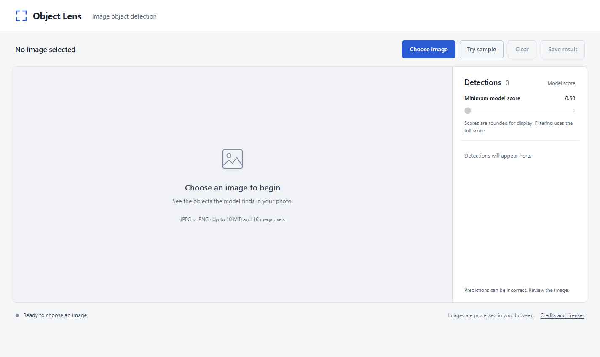

After the model has started, the workspace waits for a photo. It accepts JPEG or PNG up to 10 MiB and 16 megapixels, and Clear and Save result stay disabled until there is something to clear or save.

## 2. Detections on the sample photo

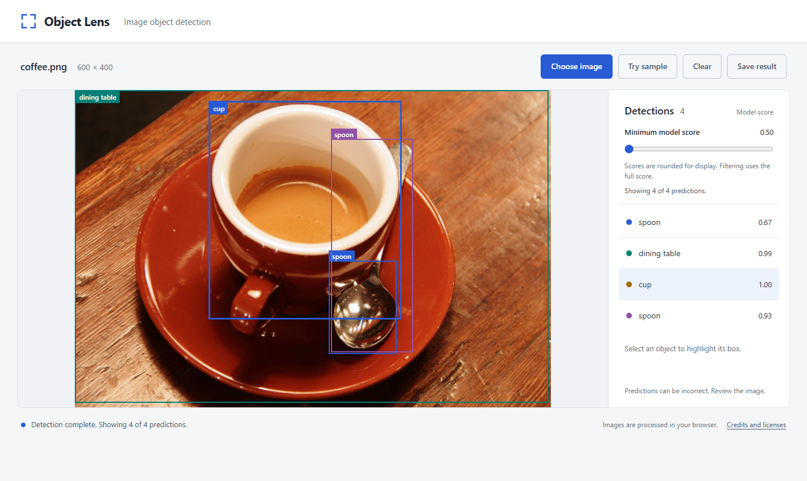

At the default minimum score of 0.50 the model's four predictions are all shown: spoon 0.67, dining table 0.99, cup 1.00 and spoon 0.93. Selecting the cup in the list highlights its row; the status reads "Detection complete. Showing 4 of 4 predictions."

## 3. Filter at 0.80

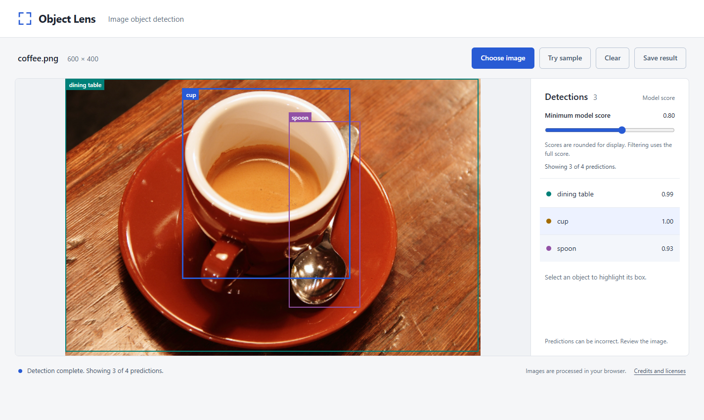

Moving **Minimum model score** to 0.80 hides the spoon at 0.67 and keeps the other three, so the status reads "Showing 3 of 4 predictions." The filter works on the existing result; the model does not run again. Scores are rounded for display, and filtering uses the full score.

## 4. Filter at 1.00

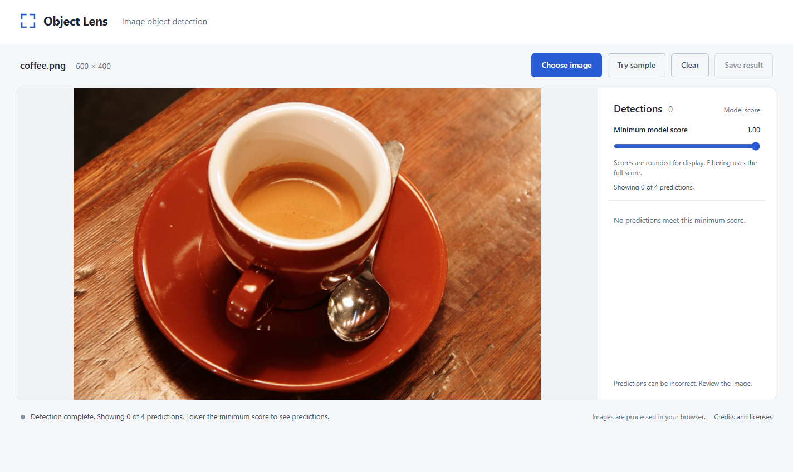

At 1.00 every prediction is hidden, because the cup's full score is just below 1 even though it is displayed as 1.00. The list says "No predictions meet this minimum score", the status suggests lowering the minimum score, and Save result is disabled. Lowering the filter brings the predictions back.

## 5. The saved result

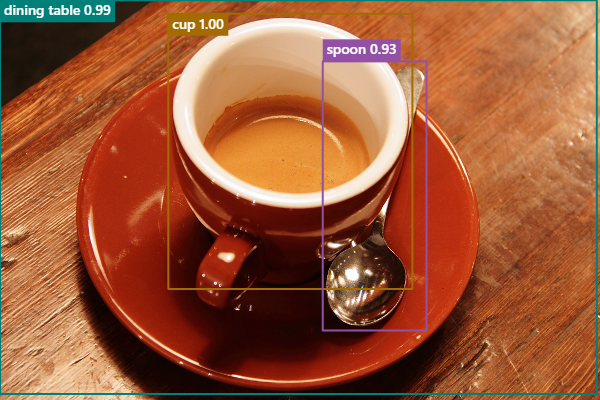

**Save result** at 0.80 downloads `coffee-object-lens-min-0.80.png` at the photo's original 600 by 400 pixels, with the visible boxes drawn on it and each label carrying its score. The hidden spoon at 0.67 is not in the file.

## 6. A file that is not an image

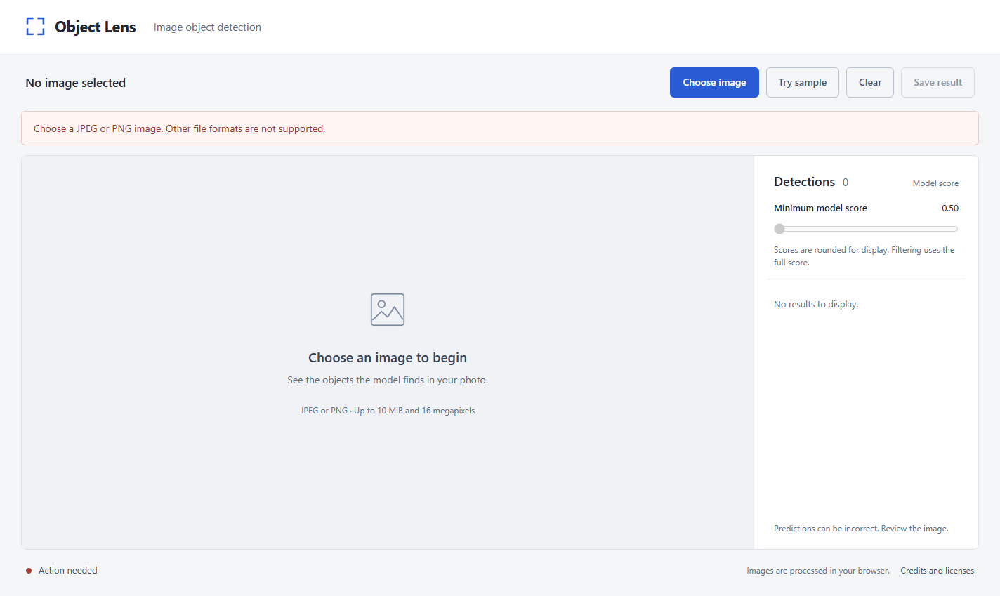

This is the real app given a deliberately unsupported text file. The message names the accepted formats and what to do next, the workspace stays empty, and the status reads "Action needed".

## 7. Image analysis took too long (controlled test worker)

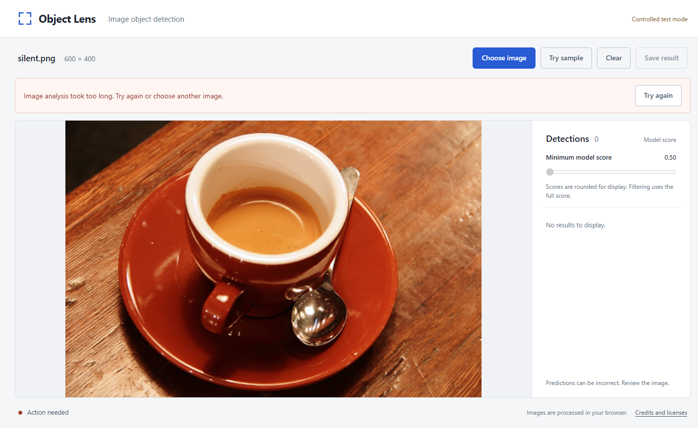

Not a model result. In controlled test mode (labelled at the top right) the test worker never answers a file whose name starts with `silent`, here a copy of the coffee photo, and the test's four-second deadline ends the analysis. The message explains what happened and offers **Try again**. The real app's inference deadline is 90 seconds.

## 8. After Clear (controlled test worker)

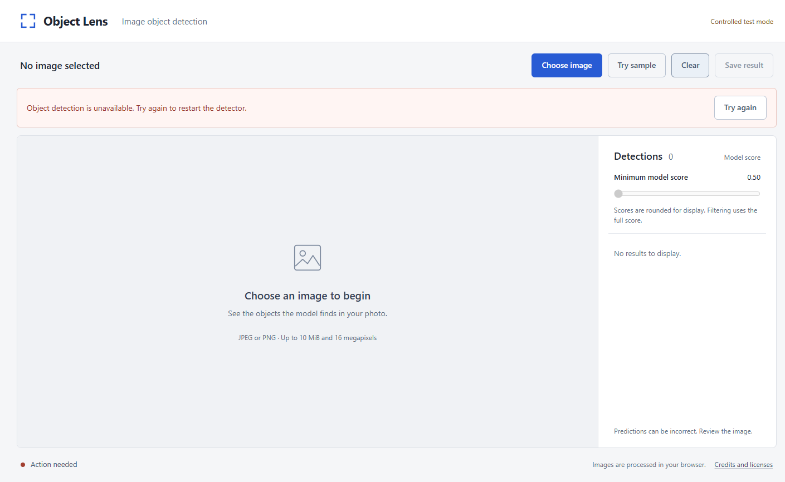

Clear removes the photo, but the timed-out detector was stopped, so the page does not claim to be ready: it says object detection is unavailable and keeps **Try again**. In the capture run, Try again then returned the app to ready.

## 9. Different widths

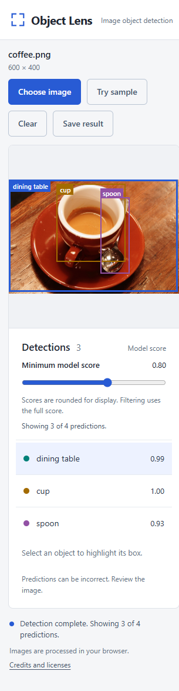
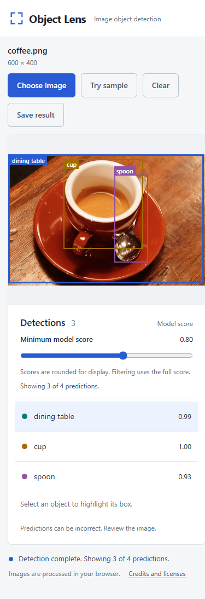
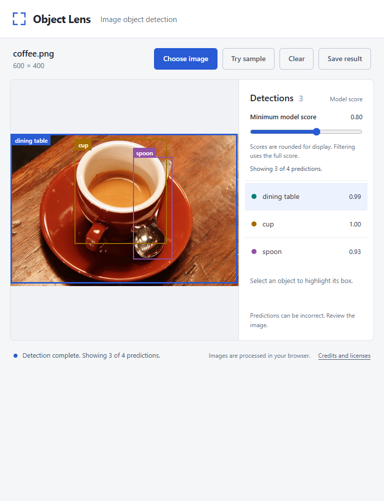

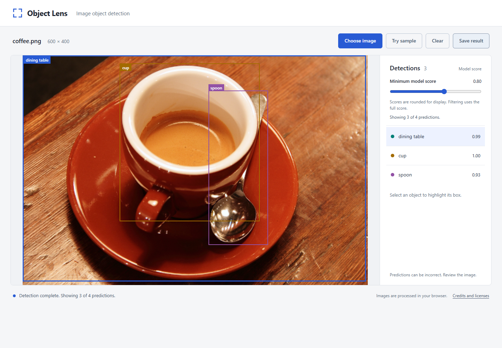

The same filtered result (3 of 4 predictions at 0.80, with the dining table selected) at 320, 390, 768 and 1440 CSS pixels. At 320 and 390 the photo and the detections stack and the buttons wrap; at 768 and 1440 they sit side by side. The capture checked that no control extends past the usable width. This is Chrome viewport emulation, not a test on a mobile device.

## 10. Other sample photos

The same app and model on the other public photos in `dist/samples` ([sources](IMAGE_SOURCES.md)). These are single real runs, not an accuracy measurement.

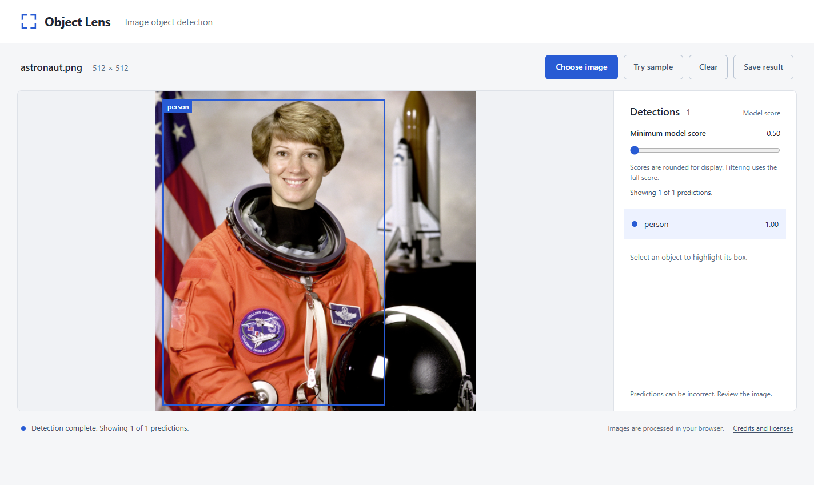

**astronaut.png**: one `person`, score 1.00, around the astronaut in the orange suit.

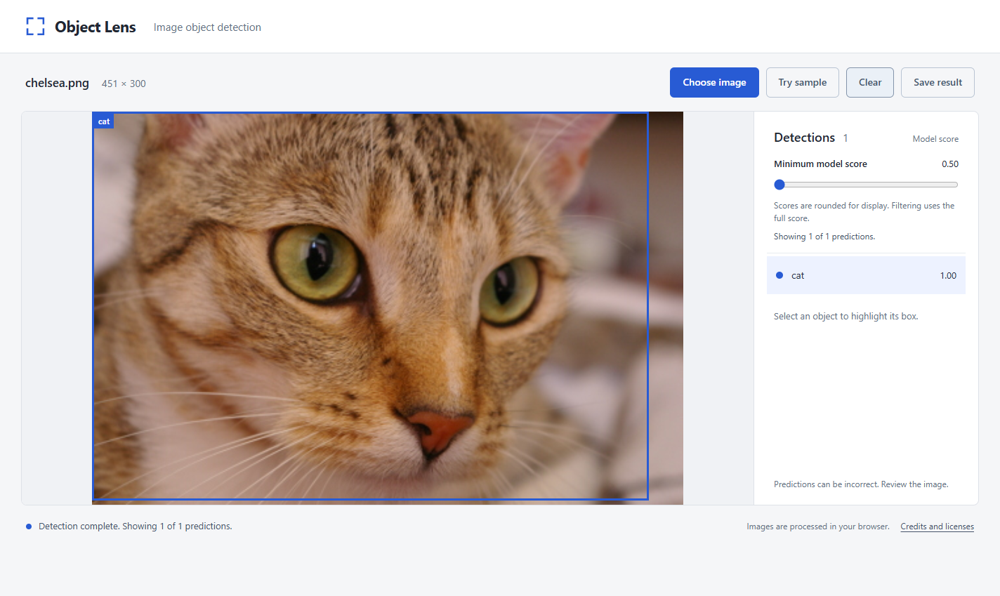

**chelsea.png**: one `cat`, score 1.00, although much of the cat is outside the frame.

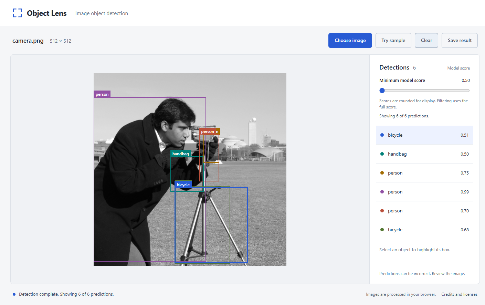

**camera.png**: the model is wrong here, and the app shows it as it is. It finds the man (`person` 0.99) but also labels the camera as two more people (0.75 and 0.70), the tripod as two bicycles (0.51 and 0.68) and the area around his hands as a handbag (0.50). Raising the minimum score to 0.80 would leave only the correct `person`. This is why the page says "Predictions can be incorrect" and why the score is called a model score, not an accuracy.

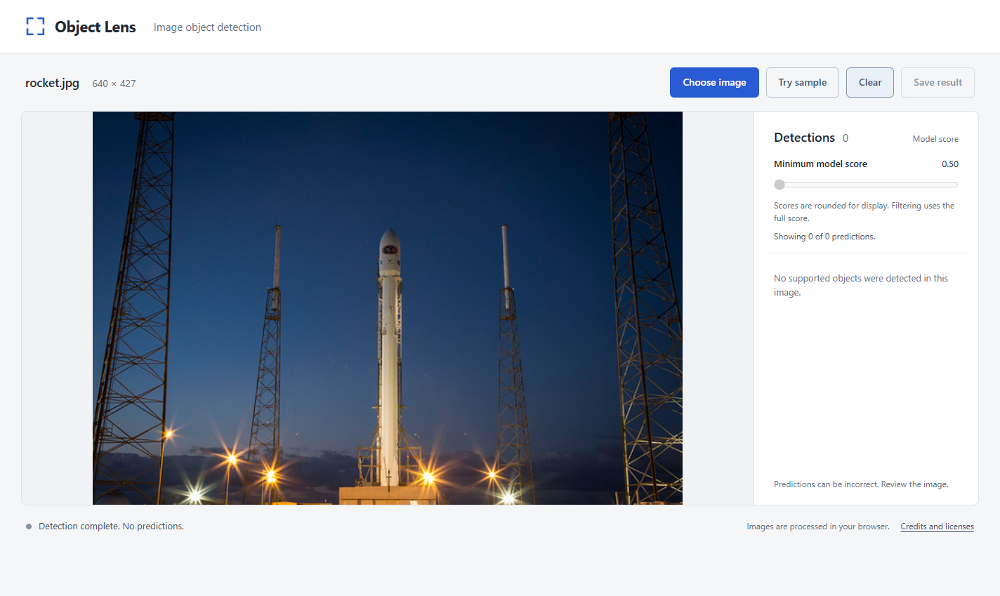

**rocket.jpg**: no predictions. A rocket is not one of the object classes the model was trained on, so the page says "No supported objects were detected in this image." That is a different message from screen 4, where predictions exist but the filter hides them.

The decisions behind these states are in [DESIGN.md](DESIGN.md), and the tests that check them are in [VERIFICATION.md](VERIFICATION.md).
